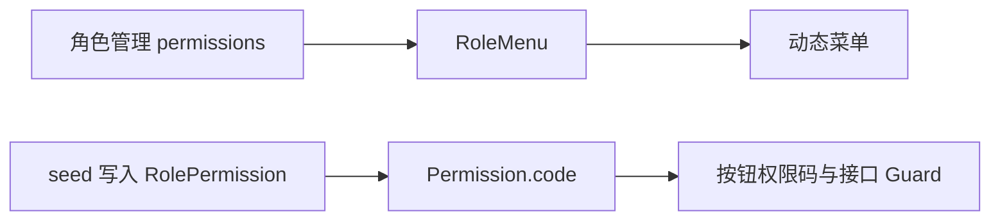

> 本文为加固前的评估基线。首批修改与验证状态见 [生产加固记录](production-hardening-2026-11-07.md)。

# 青栈企业二开底座评估

评估日期：2026-11-07。基线：`a3cfc92`，评估前工作区干净。评估对象以 `apps/server` 为主，同时核对 Vben 联调、生产镜像、Compose、CI、迁移和运维文档。

## 1. 结论

**具备值得继续建设的底座结构，但当前版本尚不能判定为合格、稳定、可直接生产交付的企业级二开底座。**

适合作为单租户后台的开发起点、内部验证版本和开源 Beta。企业生产采用前，需要先修复本文列出的权限、会话、上传和部署阻断项。它不需要为了“企业级”改成微服务，也不需要推翻 Nest + Prisma + PostgreSQL；当前最有价值的工作是让已有机制形成可靠闭环。

当前问题有两种：一是已存在且能验证的缺陷，例如角色授权与接口权限脱节、刷新令牌并发复用、上传解析阻塞、生产打包命令失败；二是尚未建立的可靠性证据，例如真实数据库并发、持续负载、滚动发布、备份恢复和多实例故障演练。后者应表述为“尚未证明”，不能直接等同于已经发生生产故障。

| 采用场景 | 当前判断 | 采用条件 |
| --- | --- | --- |
| 学习、演示、验证 Vben 接口 | 可以 | 保持开发环境隔离 |
| 单租户内部后台二开 | 可以作为起点 | 二开初期先完成阻断项，限制试用范围 |
| 面向企业的通用生产底座 | 暂不合格 | 权限、会话、上传、构建和质量门禁通过验收 |
| 对公网开放的客户后台 | 当前不建议直接部署 | 先完成安全与部署加固 |
| 多租户 SaaS、部门数据隔离 | 当前不具备 | 另行设计租户与数据范围机制 |
| 高可用、金融审计、强合规系统 | 缺乏适用证据 | 需要针对业务补可靠审计、恢复目标和专项验证 |

## 2. 本次做了什么，以及证据边界

后端生产源码约 79 个 TypeScript 文件、6,281 行，不含生成代码和单元测试。检查了认证、权限、系统 CRUD、上传、缓存、队列、审计、可观测性、数据库结构和迁移、前端请求适配、Docker 与 CI。

| 检查 | 结果 | 能说明什么 |
| --- | --- | --- |
| `pnpm build`（apps/server） | 通过 | 当前本地依赖下可以编译 |
| 单元测试及覆盖率 | 11 个套件、40 个用例全部通过 | 已有测试通过，不代表未覆盖逻辑正确 |
| 单测行覆盖率 / 分支覆盖率 | 17.45% / 12.97% | 是单测口径，未合并 E2E；包含少量生成代码 |
| 排除生成代码后的单测行覆盖率 | 约 18.16% | 低覆盖率主要来自真实业务代码，而非生成代码稀释 |
| System 模块单测覆盖 | 统计到的 850 个可执行行覆盖 0 行 | 授权与 CRUD 核心主要依赖少量 E2E |
| 仓库 E2E 静态核查 | 40 个用例 | 涵盖基本合同、上传、字典和部分 CRUD，以及模拟 Redis 错误 |
| 本地真实 PG / Redis E2E | 未执行 | Docker daemon 未运行；配置的本地 55433 / 56379 均不可连接 |
| 11 项定向诊断 | 完成 | 采用实际编译后的服务代码、实际 JWT/Nest/Express，以及必要的数据库替身 |
| 上传解析隔离实验 | 正常 PNG 完成；异常输入超时 | 实际 UploadService 调用链可触发解析阻塞；子进程 2.5 秒后由父进程终止 |
| 生产部署命令 dry-run | 失败 | 实际 `pnpm deploy` 拒绝当前工作区配置 |
| ESLint 只读检查 | 871 个 error | 855 个为格式规则，16 个为类型/安全使用规则；不是 871 个运行时缺陷 |
| 生产依赖审计 | 完成 | 默认镜像不支持 audit，改用 npm 官方 advisory endpoint；见第 6 节 |

本次没有启动、迁移、seed 或修改真实数据库，没有修改业务实现，也没有把工作推送或发布。报告是此次唯一的仓库新增文件。没有进行长时间压测、完整浏览器联调或完整 Linux 镜像构建。因此不能给出实际吞吐量、P99、SLA 或生产故障率。

服务级并发诊断使用数据库接口替身控制执行交错，证明服务层缺少必要约束；它不替代 PostgreSQL 集成测试。退出顺序与指标实验则运行了实际安装的 Nest HTTP 服务。

## 3. 已有基础中值得保留的部分

1. **模块化单体适合当前定位。** Controller / Service 分工清楚，Auth、System、Upload、Audit、Health 等边界可识别，strict TypeScript 有利于二开。当前规模没有拆微服务的必要。
2. **持久化基础合理。** PostgreSQL、Prisma migration、外键、唯一键、关联表复合主键，以及 UUID、`timestamptz`，比仅靠应用校验的模板完整。用户与角色绑定等部分写入已经使用事务。
3. **认证具备真实实现。** Argon2id、独立的 access / refresh secret、HttpOnly refresh Cookie、refresh 哈希入库、过期和吊销检查、用户 tokenVersion，均为有效基础。每次 Bearer 请求检查用户禁用/删除/版本，能够让常规改密与禁用及时影响旧 access token。
4. **已经考虑故障策略。** 登录限流和失败锁定在 Redis 不可用时拒绝登录，权限缓存则尝试回源数据库。这种按功能区分故障行为的方向是合理的。
5. **上传有防护意识。** UUID 文件名、路径约束、大小限制、MIME 识别、默认禁 SVG、`nosniff`，都应保留。问题在解析依赖及文件访问模型，而非完全没有防护。
6. **生产交付并非空白。** 已有非 root 镜像、DB/Redis 容器网络隔离、健康检查、迁移入口、生产密钥占位检查、指标保护、备份文档。
7. **Vben 契约意识明确。** 双 API 前缀、统一响应信封、refresh 返回纯 token、用户信息与角色码字段、时间格式，以及与 mock 的差异文档，减少了接入猜测。
8. **文档对部分骨架能力比较诚实。** SMTP dry-run、OTel shim、队列默认关闭、多租户未做等，已有说明。这些可选功能本身不应被要求全部实现后才能交付一个单租户底座。

## 4. 需要先解决的上线阻断项

本文 P1 表示在对应生产使用场景下应阻断上线；P2 表示随后完成的可靠性与维护性整改。没有把所有缺项都标成漏洞。

### R01 · P1 · 上传解析可阻塞服务事件循环

位置：[upload.service.ts](D:/project/vben-nest-kit/apps/server/src/modules/upload/upload.service.ts:110)、[package.json](D:/project/vben-nest-kit/apps/server/package.json:41)。

`file-type` 固定为 `16.5.4`。官方审计命中 [GHSA-5v7r-6r5c-r473](https://github.com/advisories/GHSA-5v7r-6r5c-r473)：ASF 解析遇到异常子对象大小可能无限循环，公告修复范围为 `>=21.3.1`。

当前先执行 `fromBuffer(file.buffer)`，之后才核对实际 MIME 是否在白名单中。因此“不允许上传 ASF”无法阻止 ASF 解析器被调用。正常 PNG 控制实验能完成；64 字节异常输入经真实 `UploadService.save()` 进入解析后不返回，在隔离子进程中被 2.5 秒超时终止。源码同时显示该版本 ASF 循环未保证解析位置前进。

上传需要登录，但没有独立上传权限；普通有效账号即可抵达该解析路径。单个进程的事件循环被长期占用，会影响同进程的全部请求和健康探针。文件很小，单纯降低上传字节上限不能解决。

**整改：** 升级到已修复版本并核实新版本的模块/API 兼容性；加入异常格式回归测试。若需要处理复杂不可信文件，使用可终止的隔离进程/Worker；同一事件循环中的 `Promise.race` 超时不足以终止解析循环。

### R02 · P1 · 菜单授权与接口权限是两套未闭环的数据

位置：[system-role.service.ts](D:/project/vben-nest-kit/apps/server/src/modules/system/role/system-role.service.ts:196)、[auth.service.ts](D:/project/vben-nest-kit/apps/server/src/modules/auth/auth.service.ts:389)、[permissions.guard.ts](D:/project/vben-nest-kit/apps/server/src/common/guards/permissions.guard.ts:61)。

角色接口的 `permissions` 根据合同表示菜单 ID，写入 `RoleMenu`；但 `/auth/codes` 与 `PermissionsGuard` 查询的是 `RolePermission → Permission.code`。菜单的 `authCode` 没有在这些管理写操作中同步成为接口权限。



实际服务诊断中，执行 `update(role, { permissions: [] })` 后菜单绑定清空，但重新从数据库接口读取的权限仍包含 `System:User:Delete`，没有发生任何 RolePermission 写入。**这不是等 60 秒缓存就能恢复的问题，数据库真源本身没有改变。**

反方向也成立：通过后台创建角色并勾选菜单，不能据此获得所选按钮对应的后端权限。seed 账号之所以表现正常，是 seed 单独写入了接口权限。

**整改：** 明确唯一授权真源。可让角色所选按钮菜单的 `authCode` 驱动接口权限，或明确区分菜单授权与 API 权限并提供完整管理入口。保存时使用事务更新，提交后处理缓存失效，并覆盖创建、授予、撤销、禁用、删除的闭环测试。AuthService 与 Guard 的重复权限加载逻辑应合并。

### R03 · P1 · 系统读取接口只有登录要求，缺少业务读取授权

位置：[system-user.controller.ts](D:/project/vben-nest-kit/apps/server/src/modules/system/user/system-user.controller.ts:90)，角色、菜单、部门、系统字典列表存在相同设计。

`PermissionsGuard` 在未标记 `RequirePermissions` 时直接允许。用户列表明确只有 Bearer 要求，因此即使账号没有任何角色或管理权限，也可在通过 JWT 检查后读取全局用户、姓名、角色 ID、部门和备注等信息。实际控制器元数据 + Guard 诊断确认该列表没有权限门槛。

这是当前合同选择，并非误称代码没有实现合同；但企业最小权限原则需要比 mock 合同更严格。隐藏菜单不能阻止直接调用 API。

**整改：** 定义 `System:User:List`、`System:Role:List` 等读取权限；用户、部门等查询增加数据范围约束。新增接口应显式选择“公开 / 仅登录 / 指定权限”，并用 CI 检查遗漏。

另外，用户更新可以提交任意存在的角色 ID，服务没有依据操作者限制可授予角色。若企业把 `System:User:Update` 下放给普通管理员，该权限实际上可包含给自己或他人授予高权限角色的能力。应增加独立授权权限、可授予角色边界及保底管理员保护；如果产品明确只有最高管理员能管理账号，则应把这一限制写成可验证规则。

### R04 · P1 · refresh 消费非原子，且与改密吊销存在竞态

位置：[auth.service.ts](D:/project/vben-nest-kit/apps/server/src/modules/auth/auth.service.ts:297)、[system-user.service.ts](D:/project/vben-nest-kit/apps/server/src/modules/system/user/system-user.service.ts:284)。

当前步骤为：读取 refresh 记录 → 检查未吊销 → 读取用户 → 按 ID 无条件更新旧记录 → 创建新 refresh。它没有原子地确认旧令牌只被消费一次，也没有把消费与新令牌创建放在一个完整的一致性边界内。

可重现的两种交错：

- 同一旧 refresh 同时发起两个请求，两者先读到未吊销状态，随后都成功，最终产生两个有效 refresh 分支。服务级并发实验观察到 `successful=2`、`activeRefreshTokens=2`。
- refresh 先读到旧用户和令牌，管理员改密并提交 tokenVersion 增加与旧令牌吊销，然后在途 refresh 继续创建新令牌。新 refresh 没有会话版本约束，再次刷新时能取得当前 tokenVersion 的有效 access。服务级受控交错实验确认了这条路径。

还存在旧令牌已经吊销、新令牌创建失败时用户失去会话的部分失败窗口。当前也没有 refresh 家族与重放处置机制。

**整改：** 采用带条件的原子消费；消费旧令牌与插入新令牌应在一致的事务内。改密/禁用/登出与 refresh 必须共享会话版本或锁定协议，可考虑 session epoch + 用户行锁，或适当隔离级别与重试。仅简单包一层默认事务，不能自动消除与改密交错的问题。用真实 PG 测试同 token 并发、改密并发、吊销并发与事务中途失败。

普通登出目前只吊销 refresh，旧 access 在其剩余生命周期内仍可使用；这是应明确的会话语义。若产品要求立即踢下线，需要 session 标识/状态或相应版本策略。logout 还会吞掉数据库异常并返回成功，应区分无效 cookie 与吊销存储失败。

### R05 · P1 · 当前生产镜像部署命令存在确定失败点

位置：[Dockerfile](D:/project/vben-nest-kit/apps/server/Dockerfile:48)、[pnpm-workspace.yaml](D:/project/vben-nest-kit/pnpm-workspace.yaml:1)。

Dockerfile 执行 `pnpm --filter @qingzhan/server deploy --prod /out`，工作区未配置 `injectWorkspacePackages`，也未使用 legacy deploy。以项目当前 pnpm 运行同命令的 dry-run，返回：

```text
ERR_PNPM_DEPLOY_NONINJECTED_WORKSPACE
By default, starting from pnpm v10, we only deploy from workspaces
that have "inject-workspace-packages=true" set
```

因此后端编译通过、HTTP E2E 通过，都不能代表 Docker 生产交付链可用。完整 Linux 镜像仍可能存在其他尚未执行到的兼容问题，本次不将此 dry-run 当作完整构建。

**整改：** 选择并验证 legacy deploy，或完整配置 injected workspace 及对应 lockfile；增加真实镜像构建、启动、migrate、ready/login 的 CI 验收。生产 runtime 为 Node 22，而现有后端 CI 使用 Node 24，也应覆盖正式支持的运行时。

### R06 · P1（入口可直连时）· 代理信任与公开端口组合可伪造 IP

位置：[main.ts](D:/project/vben-nest-kit/apps/server/src/main.ts:17)、[compose.prod.yml](D:/project/vben-nest-kit/compose.prod.yml:57)。

全局固定 `trust proxy = 1`；Compose 把 API 映射到宿主所有接口。若外部可以直接访问该端口，就能自行设置 `X-Forwarded-For`，影响 `req.ip`。实际 Express 诊断已确认服务接受自填转发 IP。

这会影响登录 IP 失败锁定、IP 限流和审计来源。它不等于所有登录保护失效：用户名失败锁定仍然存在。若前方已有只允许代理访问的网络控制，则风险取决于代理如何清理该请求头。

**整改：** 将 API 绑定回环/内部网络，禁止绕过代理；按可信代理地址配置 trust，而非无条件假定一个跳数；代理覆盖而不是透传不可信转发链。加入直连与经代理两类验收。

### R07 · P1（滚动发布要求下）· 退出钩子不等于请求已排空

位置：[main.ts](D:/project/vben-nest-kit/apps/server/src/main.ts:72)、[prisma.service.ts](D:/project/vben-nest-kit/apps/server/src/prisma/prisma.service.ts:21)、Redis/Queue 的销毁钩子及部署文档。

数据库在 `OnModuleDestroy` 中关闭。当前实际安装的 Nest 生命周期中，模块销毁先于 HTTP adapter 的最终关闭；启用 shutdown hooks 本身没有增加项目级摘流、在途请求跟踪和 drain 协议。

使用真实 Nest HTTP 服务及模拟数据库销毁钩子，慢请求开始后调用关闭：先发生 `db-disconnect`，后发生 `handler-use-db`，请求返回 500。该实验验证生命周期风险，不等同于已经在真实 PG/容器滚动发布中观测到故障。

**整改：** 明确“进入 draining 状态 / readiness 失败 → 停止接新业务请求并等待在途请求 → 关闭连接池”的顺序，并设置最大等待期限。用持续请求覆盖实际 SIGTERM、Compose 重启及未来滚动发布。同步纠正文档中“自动先 drain 再断依赖”的过强描述。

## 5. 第二阶段应完成的可靠性与二开整改

### R08 · P2 · 当前 captcha 是可自动取得答案的票据

位置：[captcha.service.ts](D:/project/vben-nest-kit/apps/server/src/modules/auth/captcha/captcha.service.ts:61)、[前端 auth.ts](D:/project/vben-nest-kit/apps/web-antd/src/store/auth.ts:67)。

公开接口同时返回 `captchaId` 和用于验证的 `captchaToken`，前端拿到后直接提交，没有服务端可验证的人机挑战。自动化客户端同样可按两步请求完成。SliderCaptcha 的前端交互不能自动转化为后端防机器人证据。

另外 GET 后 DEL 的消费方式非原子，服务级并发实验中同票据被接受两次。它可以作为流程票据，但不能宣传为有效的人机防护。改为真实挑战或可信验证服务，消费使用 GETDEL/Lua，并按需要绑定会话、来源或尝试次数。

### R09 · P2 · 禁用角色后菜单与用户信息仍可能包含该角色

位置：[menu.service.ts](D:/project/vben-nest-kit/apps/server/src/modules/menu/menu.service.ts:37)、[user.service.ts](D:/project/vben-nest-kit/apps/server/src/modules/user/user.service.ts:12)。

权限码查询过滤 `Role.status=1`；菜单通过用户所有 roleId 查 RoleMenu，没有角色状态过滤。login 和 user/info 返回角色码时也没有过滤禁用角色。结果是接口权限、菜单、前端角色判断可能出现不同状态。服务级查询诊断确认缺少该谓词。

禁用角色不意味着 API Guard 继续从数据库授予该角色权限；问题在各条消费路径不一致，并可能叠加权限缓存窗口。统一从启用角色集合派生菜单、角色码、权限码。

### R10 · P2 · 权限缓存删除是尽力而为，没有严格撤权保证

位置：[redis.service.ts](D:/project/vben-nest-kit/apps/server/src/redis/redis.service.ts:86)、角色和用户服务的缓存清理。

数据库提交后删除权限缓存方向合理，但 Redis.del 吞异常；并发的旧读取还可能在删除后回填旧值。旧授权存在最多 TTL 级别的窗口，需要在产品安全语义中明确。对高风险撤权可采用权限版本化缓存、会话 epoch，或短暂直读真源；避免单靠异步删缓存承诺即时一致。

### R11 · P2 · 审计不是可靠审计链

位置：[audit.service.ts](D:/project/vben-nest-kit/apps/server/src/modules/audit/audit.service.ts:76)。

审计是 fire-and-forget，数据库写失败仅 warn，没有事务 outbox、重试、积压指标或退出 flush。业务成功后进程退出/连接池关闭，审计可能丢失。多数系统写操作只记录 ID、字段名，缺少变更前后值；系统写失败及被 Guard 拒绝也没有完整操作审计。脱敏只检查 detail 顶层 key，未来嵌套对象可能绕过它。

普通运维事件记录可采用这种轻量方案；涉及财务、账号授权追责、合规的审计，应改用与业务事务一同提交的 outbox/审计记录，再异步归档，并增加递归脱敏、保留策略和可追踪目标实体。

### R12 · P2 · 500 被隐藏了，但服务端排错证据也不足

位置：[http-exception.filter.ts](D:/project/vben-nest-kit/apps/server/src/common/filters/http-exception.filter.ts:19)、[http-metrics.interceptor.ts](D:/project/vben-nest-kit/apps/server/src/observability/http-metrics.interceptor.ts:10)。

对客户端隐藏 Prisma 异常细节是正确的，但全局过滤器没有记录原始异常/堆栈及 requestId。StructuredLogger 定义了却未接入主要调用链，也没有完整请求完成日志。这样生产上可能只能看到用户收到 500，难以定位原因。

指标在 interceptor 中采集，而 Guard 先于 interceptor 执行；401、403、限流 429/503 等可漏计。真实 Nest 实验发送一个成功请求和一个 Guard 拒绝请求，HTTP counter 只增加 1。应在 response finish/close 等统一出口采集状态、耗时并关联 requestId，再增加必要的依赖/连接池/事件循环指标。

OTel 当前是 noop shim，并没有真实 HTTP/DB trace，也未见业务 startSpan 的接入。应把它定位为扩展预留；是否接真实 OTel可依据业务需求决定，不应把开关存在当作已具备分布式追踪。

### R13 · P2 · 参数与错误规范尚未全面统一

位置：[system-user.service.ts](D:/project/vben-nest-kit/apps/server/src/modules/system/user/system-user.service.ts:107)，其他列表接口存在相似代码。

Body 多数有 Zod，但 Query 和 Param 缺少等强度验证。UUID 路径多只检查非空，错误 UUID 可能变成 Prisma 异常和 500；重复查询参数可产生数组，服务按字符串调用 `.trim()`。数组型 name 的服务诊断已产生 `trim is not a function`。

page/pageSize 多处复制 parseInt，接受 `1abc` 等输入，并且没有稳定的最大 page/offset 约束。数据库唯一冲突只在部分服务映射 409；外键、并发不存在等错误也缺少统一分类。

统一查询 schema、UUID pipe、分页规则、标量/数组策略及 Prisma 错误映射，尽量将客户端错误稳定返回为 400/404/409。Swagger 当前也主要标注路由，不能充分表达这些 unknown body 的实际请求 schema；二开时应提供 schema 驱动文档或类型化 DTO。

### R14 · P2 · 部分检查后写入存在并发窗口

位置：[system-dept.service.ts](D:/project/vben-nest-kit/apps/server/src/modules/system/dept/system-dept.service.ts:145)、[system-menu.service.ts](D:/project/vben-nest-kit/apps/server/src/modules/system/menu/system-menu.service.ts:126)。

部门删除先检查孩子与用户计数，再单独软删除；并发分配用户/新增子部门可跨过检查，因为软删除不会触发外键删除约束。菜单/部门防环先读树再改父节点，并发移动也没有序列化约束。这些是源码可识别的竞态窗口，本次未用真实 PG 复现。

菜单 path 在应用层判重但数据库无相应唯一约束，存在并发重复窗口；另一方面，全类型统一判重又可能阻止本应无路由 path 的多个按钮。应先定义路由/按钮的唯一性语义，再用匹配语义的数据库约束兜底。

多人同时编辑用户角色或角色菜单采用覆盖式写入，没有版本/更新时间前置条件，可能发生后提交者覆盖先提交者。对重要配置引入乐观版本或明确覆盖策略。仅给多个 SQL 包事务并不自动解决这些业务并发问题。

### R15 · P2 · 部分更新语义与菜单树健壮性需统一

位置：[system-menu.service.ts](D:/project/vben-nest-kit/apps/server/src/modules/system/menu/system-menu.service.ts:165)。

用户/角色更新会区分“字段省略”和“显式清空”，菜单更新却把省略 pid 变为根节点、缺失 meta 变成空对象，其他可选值也可能被清空。即使当前 UI 通常传完整对象，二开 API 客户端也容易踩坑。应明确 PUT 全量替换或 PATCH 部分更新，并保持接口文档与实现一致。

动态菜单只返回已授权的节点；若仅授权叶子但缺少父节点，buildTree 会丢弃该节点，需要保存时补齐祖先或明确定义行为。防环/最大深度、非正常历史树处理也应统一。

### R16 · P2 · 上传当前是公共文件能力

位置：[main.ts](D:/project/vben-nest-kit/apps/server/src/main.ts:46)、[storage.types.ts](D:/project/vben-nest-kit/apps/server/src/modules/upload/storage/storage.types.ts:19)。

本地 uploads 作为 Express 静态目录直接访问，不经过 JWT/权限 Guard。随机 UUID URL 降低猜测概率，但不构成文件授权。没有文件元数据实体、所有者、业务关联、删除/配额/生命周期与私有下载策略。

适合公开头像和公开素材；企业合同、财务附件、客户文件需要独立的私有访问模型。Multer 使用内存存储，单文件有限制但并发内存、总量及磁盘容量没有统一限制，也应验证。

### R17 · P2 · 数据规模和长期运行边界缺少验证

- `RefreshToken` 每次登录/刷新插入，未见定期清理，且缺少面向到期清理的 expiresAt 索引。AuditLog 也没有已落地的归档/保留机制。
- 用户列表按创建时间排序、按名称/备注 contains 搜索；大表时需要结合实际 SQL/EXPLAIN 设计索引、搜索方式与分页，不能直接承诺性能。
- 关联表主键通常以 userId 或 roleId 开头；反向 roleId/menuId 查询与清理需依据执行计划补索引。
- 字典 all 按类型逐项查询，存在 N+1；直接按 code 查启用项没有过滤字典类型 status，和 all 的禁用类型语义不完全一致。
- 字典版本依赖 Redis，写库成功而 bump 失败再恢复后，现有缓存可能继续接受旧版本；随机/计数版本在 Redis 重建后的单调性也需设计。
- 部门/菜单全树读取与递归构建适合有限规模，未设深度与数据量预算。
- Prisma adapter 没有显式业务超时/连接池预算；ready 的 DB 查询也未设项目级 deadline。Redis 有 2 秒命令超时，但一个请求可能串行发生多次缓存访问，故障时尾延迟会累加，回源也可能放大 DB 压力。

这些多数是规模风险，不能在没有压测数据时断言已经慢。应记录测试机器、数据量、连接池、并发、错误率与 P50/P95/P99，再制定容量边界。

### R18 · P2 · 多实例能力只能部分成立

Redis 支撑分布式限流，PG 提供共享真源，是多实例的有效基础。但本地磁盘上传在多机之间不共享；Demo timezone 是进程内单个变量，所有账号共用、重启丢失、多实例不一致。它应保持 Demo 身份，真实偏好应按用户持久化。

当前 Compose 是单套 server/PG/Redis，没有副本切流、自动故障转移或经过演练的恢复目标。Docker healthcheck 变成 unhealthy 不会仅凭 restart policy 自动修复所有应用层卡死；不要把存在 healthcheck 当作具备高可用。

单节点部署不是所有后台的缺陷，只要产品明确可接受停机窗口；若承诺高可用，需要另外完成架构和演练。

### R19 · P2 · 生产初始化与配置仍容易误用

位置：[seed.ts](D:/project/vben-nest-kit/apps/server/prisma/seed.ts:297)、[env.ts](D:/project/vben-nest-kit/apps/server/src/common/config/env.ts:14)、[compose.prod.yml](D:/project/vben-nest-kit/compose.prod.yml:59)。

- seed 不只是首次创建：upsert update 会把 demo 账号密码重置为公开的 `123456`、重新启用并清除 deletedAt。没有生产拒绝门槛；也没有同步提升 tokenVersion/统一吊销会话。生产重复 seed 尤其危险。
- 生产入口只 migrate，不会建立安全的首个管理员；应提供独立、显式、只初始化一次的管理员引导，避免只能照抄 demo seed。
- 配置 schema 验证了必需项，但数值缺少全面的正数/整数/上界，JWT TTL 缺少严格格式验证。诊断中 `UPLOAD_MAX_BYTES=-1` 和无效 TTL 均被接收；实现可能回退或产生不一致。
- `NODE_ENV` 任意字符串、两类 JWT secret 可相同等配置仍缺少约束；SameSite=None 与 Secure 的组合也需要验证。
- Compose 没有透传文档支持的 S3 凭证/endpoint/bucket 等配置；仅设置 `STORAGE_DRIVER=s3` 不足以使用该生产模板。队列、SMTP、captcha 等也不是修改 env-file 任意键就会自动注入容器。
- 生产登录 Cookie 如需跨源使用，login 请求也要显式 credentials；当前只 refresh/logout 设置了 withCredentials。同源反代模式可正常工作，跨域模式应专门联调。Cookie 端点在 SameSite=None 等部署下需要明确 Origin/CSRF 策略，CORS 不能代替所有 CSRF 检查。

本次验证当前安装的 ConfigService 会把 SWAGGER_ENABLED 取为 boolean，生产 true 开关有效；**没有将其误列为配置缺陷**。

### R20 · P2 · 质量门禁和完整前端交付尚未闭环

位置：[后端 CI](D:/project/vben-nest-kit/.github/workflows/qingzhan-server-e2e.yml:140)、[上游 CI](D:/project/vben-nest-kit/.github/workflows/ci.yml:21)。

后端专用 CI 会构建与跑 HTTP E2E，这是优点，但没有执行后端 40 个单元测试、覆盖率门槛、只读 lint 或生产镜像启动。上游 ci.yml 和 CodeQL 仍绑定 `vbenjs/vue-vben-admin`，fork 并不会自动获得这些质量门禁。生产 Compose / Dockerfile 等变更路径也应全部触发对应交付检查。

现有 E2E 大部分抬高限流并使用 memory storage；另有专门用例 mock Redis eval/getStrict 错误，不能说完全没测故障策略，但缺少真实停 Redis/恢复、多实例限流、刷新重放、即时撤权与改密并发等验证。测试自行搭建 bootstrap，和 main 的 CORS、代理、静态文件及 shutdown 设置也不完全一致。

web-antd 已接 Nest 认证与后端动态菜单，但系统管理 UI/API 主要在 playground，playground 默认仍启用 mock；web-antd 的生产 API 地址仍为上游 mock，并有注释要求部署时替换。当前更接近“后端服务 + Vben 接入样例”，尚不是开箱即用的企业管理产品。应选定一个正式支持的前端，将用户/角色/菜单/部门/字典页面迁入或明确给出完整接入路径，并执行浏览器级验收。

MIT 与保留上游版权的方向合理。本项目包版本仍 0.1.0，而文档已有 v0.2.0；部分 README/release 草稿状态及上游仓库元数据也应整理。建议建立版本兼容矩阵、升级说明、安全漏洞反馈渠道与 release checklist，减少企业采用后的维护成本。

## 6. 依赖审计的正确解读

命令：`pnpm audit --prod --registry https://registry.npmjs.org --json`。检查的是当前锁文件，而非仅 apps/server 独立目录。

整个 workspace 返回 82 个公告记录：2 critical、37 high、31 moderate、12 low。**这不能表述为“后端有 82 个可利用漏洞”**；工作区包含多个前端、内部构建包与 mock，且 workspace 的 production dependency 分类仍包含某些工具包的依赖树。

筛选依赖路径以 `apps__server>` 开头后，得到 11 个公告、涉及 2 个包：

| 包 | 公告情况 | 本次可确认程度 |
| --- | --- | --- |
| file-type | 1 个 moderate，无限循环 | 直接生产依赖，实际上传调用链触发；按本项目影响提升为 P1 优先处理 |
| fast-uri | 10 个，5 high / 3 moderate / 2 low | 经 Prisma CLI 的开发工具依赖链带入；尚未证明 API 请求可直接利用，需做可达性与镜像裁剪检查 |

建议以“包版本 → 出现在什么制品 → 能否被不可信输入触达 → 修复与回归”管理漏洞，不以公告数量代替工程判断。生产依赖包含 Prisma CLI 是为了启动迁移，可以考虑独立迁移任务/制品以缩小 API runtime 攻击面。

默认 npmmirror 不支持本次 audit endpoint，CI 应指定可用的审计源或使用可验证的 SCA 服务，避免“没有报告”等同于“没有漏洞”。

## 7. 建议的整改顺序

### 第一阶段：形成可信的单租户安全底座

1. 修复 file-type 解析风险并添加异常文件回归。
2. 打通菜单/按钮/API 权限真源；完成读权限、禁用角色、可授予角色边界。
3. 修复 refresh 原子消费与改密/吊销并发，明确登出语义。
4. 修复生产 deploy 命令，完成真实 Linux 镜像构建与启动验证。
5. 加固可信代理与入口网络，完成 drain 顺序。
6. 提供安全的首管理员初始化，阻止生产 demo seed 误操作。

### 第二阶段：把“正确”变成持续可验证

1. 后端 CI 必须执行 unit、真实 PG/Redis 集成/E2E、只读 lint、依赖检查、镜像烟测。
2. 对权限、session、用户/角色写入设专项回归，优先看关键分支和安全不变量；不以机械追求全仓 80% 覆盖率替代它们。
3. 统一 Query/Param/body、数据库错误码、更新语义和并发策略。
4. 补完整异常日志、响应完成指标、审计可靠性和清理任务。
5. 正式前端完成完整管理流程的浏览器验收。

### 第三阶段：依据目标业务补容量与运维保障

建立真实数据量基线；验证 Redis 故障/恢复、DB 超时/重连、持续负载、发布 drain。执行备份恢复并记录 RPO/RTO，再按需求决定私有文件、独立 worker、邮件、OTel、多租户、数据权限细分和高可用。

## 8. 可以宣称“合格底座”前的最低验收

- 新建角色 → 授权菜单和按钮 → 分配用户 → 页面与接口一致；撤权、禁用、删除后符合已定义的生效时限。
- 无角色账号不能读取管理数据；委派管理员不能给自己授予越权角色；至少一个受保护的管理入口可恢复。
- 同一个 refresh 并发只允许一次成功；旧 token 重放被识别；改密/禁用与在途 refresh 不会留下可用新会话。
- 异常文件有界时间内拒绝，不阻塞健康检查；公开/私有文件的访问规则明确。
- 从干净 checkout 能冻结依赖、构建镜像、迁移新库、安全初始化管理员并运行完整管理流程。
- API 入口不可绕过可信代理；跨域 Cookie 配置经过浏览器验证。
- 持续业务请求下停止/升级服务，在约定 drain 时限内完成，失败和丢失均有记录并符合预期。
- Redis 中断和恢复后认证、权限、限流和字典行为可预期；数据库超时有界，错误可观测。
- 备份恢复到新实例后，账号、权限、业务数据和文件可用，并记录实际恢复耗时。
- 公布受支持的前端/Node/Postgres/Redis 版本、已知限制、升级步骤及安全反馈渠道。

**定位建议：目前对外称“面向 Vben 的 NestJS 后端开发底座 / Beta”更符合证据；完成第一、二阶段并取得第三阶段中与目标业务对应的验证结果后，再使用“企业级二开底座”的承诺。**

## 附：本次诊断产物

以下为本机评估产物，未加入源码仓库，也不会在仅克隆本仓库后自动存在：

- [定向诊断代码](C:/Users/xiangxiang/.codex/visualizations/2026/11/07/01a1b3ef-eb38-7563-8a53-3e10cb037092/enterprise-review/probes.cjs)
- [11 项诊断结果](C:/Users/xiangxiang/.codex/visualizations/2026/11/07/01a1b3ef-eb38-7563-8a53-3e10cb037092/enterprise-review/probe-results.json)
- [上传解析隔离实验代码](C:/Users/xiangxiang/.codex/visualizations/2026/11/07/01a1b3ef-eb38-7563-8a53-3e10cb037092/enterprise-review/upload-parser-probe.cjs)
- [上传解析实验结果](C:/Users/xiangxiang/.codex/visualizations/2026/11/07/01a1b3ef-eb38-7563-8a53-3e10cb037092/enterprise-review/upload-parser-result.json)
- [npm 依赖审计原始结果](C:/Users/xiangxiang/.codex/visualizations/2026/11/07/01a1b3ef-eb38-7563-8a53-3e10cb037092/enterprise-review/dependency-audit-npm.json)
- [ESLint 原始结果](C:/Users/xiangxiang/.codex/visualizations/2026/11/07/01a1b3ef-eb38-7563-8a53-3e10cb037092/enterprise-review/eslint.json)

本地构建与单测复核命令（apps/server 目录）：

```sh
pnpm build
pnpm test --runInBand --coverage --coverageReporters=json-summary --coverageReporters=text-summary
```

单测覆盖率原始摘要在 `apps/server/coverage/coverage-summary.json`（gitignored）。诊断代码绑定本机绝对路径，复用时需要改成实际 checkout 路径。并发实验采用接口替身，不向真实数据库发送请求；上传实验只运行于有超时终止的本地子进程。
